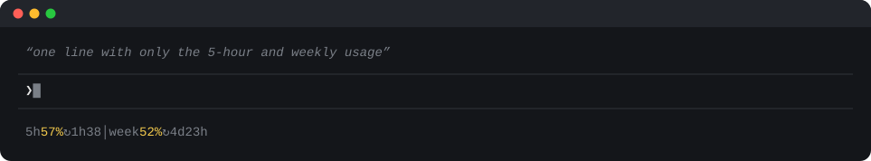
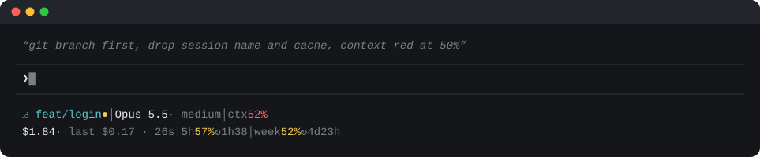

<p align="center"></p>

<h1 align="center">calmline</h1>

<p align="center">A quiet status line for Claude Code.<br>Grey until something needs you. No config file: ask your Claude to change it.</p>

---

## Install

In Claude Code:

```
/plugin install calmline --marketplace michalklejdysz/calmline
/calmline:install
```

Plugins can't set the status line themselves, so the second command does it. Your previous status line is saved first, and you can ask for it back.

<details>
<summary>Without the plugin</summary>

```sh
curl -fsSL https://raw.githubusercontent.com/michalklejdysz/calmline/main/install.sh | sh
```

Or with git, so updates are a `git pull`:

```sh
git clone https://github.com/michalklejdysz/calmline ~/.claude/calmline && sh ~/.claude/calmline/install.sh
```
</details>

## Make it yours

One sentence to Claude is enough. Each layout below is what **Opus 5.5 wrote from the prompt in its caption, on the first try**, touching only `my_segments.py`:

<p align="center"></p>
<p align="center"></p>

More to try:

> Add a segment with the active Python venv.

> Show the Node version when there is a package.json.

> Make the weekly limit turn yellow at 30%.

Your changes live in `~/.claude/calmline/my_segments.py`. Updates never touch it. [CLAUDE.md](CLAUDE.md) tells your Claude the rules: what data exists, how to test, what keeps the line fast.

## What the default shows

- **Top line:** session, folder, git branch (● = uncommitted changes), model and effort (⚡ fast mode), context used, cache hits
- **Bottom line:** session cost, cost and time of your last turn, 5-hour and weekly limits with time to reset

Colour only where you act on a number: context at 40/70%, limits at 50/80%. Everything else stays grey.

## Updates

With the plugin, updates arrive like any plugin update, and the new version is copied in at your next session start. With curl, run it again. With git clone, `git pull`.

## Safe by default

- A segment slower than 300 ms is dropped, so the line never lags
- A broken segment shows `name !` and the rest still renders
- No network and nothing leaves your machine; one small state file holds the last-turn numbers

## Requirements

Python 3.8+, standard library only (macOS ships `/usr/bin/python3`). Git is optional: without it the branch is just hidden. Any terminal with colour and UTF-8 works, with a font that has `⎇ ↻ ⚡` (SF Mono, JetBrains Mono, any Nerd Font). The 5h and weekly limits show only on a Claude subscription (Pro/Max): Claude Code doesn't send them to API-key users.

**Tested on:** Claude Code 2.1.301 with Opus 5.5, macOS, iTerm2; tests pass on Python 3.8, 3.9 and 3.14. Windows runs it without the 300 ms cut-off (`signal.setitimer` is Unix only).
